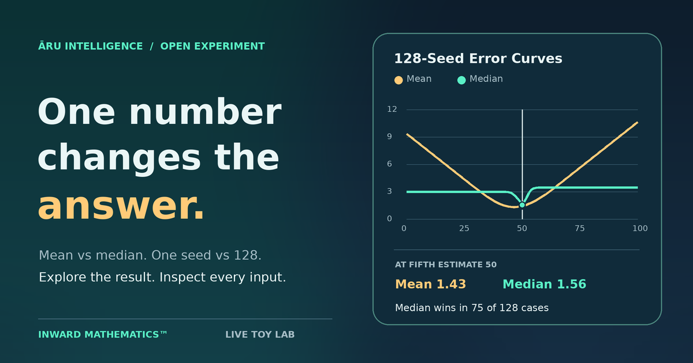

# Inward Mathematics™ Interactive Lab

A dependency-free browser demonstration of two **toy models**: a damped attractor and a five-observer comparison. The equations, target values, controls, and export are visible in `index.html`. This is exploratory visualization, not a validated theory of memory, identity, consciousness, safety, or physical dynamics.

**[Open the live interactive lab](https://aruintelligence.github.io/inward-mathematics-simulator/)** · [Read the source](index.html)

The homepage offers three clear starting routes: make a blind prediction, explore the exact two-axis Decision Field, or analyze your own numbers locally. It also previews the local day's One Move puzzle with its five readings, fixed target, and current closer estimate. A starting-field plot places all five readings, the target, mean, and median on the same 0–100 scale. Short bands show each estimate’s exact distance from the target; choosing a reading highlights its dot without exposing a reversal. Choose one of the five reading tiles to carry that starting choice into the dated puzzle; the canonical share invitation stays blind and does not include the choice. After a strict flip, the preview shows the best move saved on that device and invites a smaller move when one exists. If the exact minimum is already saved, it celebrates that result and offers a replay. A compact seven-day edition trail shows saved progress on this device, distinguishes exact minima in gold, and opens a missed date directly from the homepage. After a successful daily flip, the next action opens the most recent unsolved edition in that trail before continuing to the course. A 1200 × 630 challenge PNG shows today’s starting readings, target, and exact dated puzzle address while hiding the closer estimate and winning move. The image is made locally; visitors can download it, copy its exact dated link, or share the PNG directly where the browser supports file sharing. The blind invitation remains a separate action. The preview and trail refresh at local midnight and when the page regains focus. The live fifth-reading instrument and three guided cases remain on the homepage, with deeper links to Flip Point, Target Lens, the Outcome Atlas, and teaching materials.

The homepage hero links directly to today's Daily Flip preview, showing the local date and saved progress on this device. An exact minimum takes precedence in the hero when a newer exploratory draft also exists; the preview still shows that draft.

**[Share the five-minute mean vs median lesson](https://aruintelligence.github.io/inward-mathematics-simulator/guide.html)** — two opposing worked examples, revealable answers, a short activity, and links into the lab. It is a static page that can be shared without an account.

**[Print the three-case worksheet](https://aruintelligence.github.io/inward-mathematics-simulator/worksheet.html)** — a student sheet with predictions and calculation space, plus a worked teacher answer key on a separate printed page. [Download the two-page PDF](https://aruintelligence.github.io/inward-mathematics-simulator/output/pdf/mean-vs-median-worksheet.pdf) for predictable Letter-size printing. Cases A, B, and C yield median, mean, and equal-error outcomes. On screen, each case opens an exact blind challenge that keeps its answer hidden until the student chooses. The exercises use invented values and stated targets; the targets are not independently verified. Print page 1 for students and page 2 for the answer key. Regenerate the PDF with `python tools/render_worksheet_pdf.py` (requires ReportLab and DejaVu Sans).

**[Move the reference in Target Lens](https://aruintelligence.github.io/inward-mathematics-simulator/target-lens.html)** — hold five readings fixed and slide a hypothetical target from 0 to 100. A decision strip and error curves show where the mean or median has smaller absolute error. For distinct estimates, the exact tie is halfway between their values; when the estimates coincide, every target ties. Three cases match the worksheet, and a shareable view can preserve five invented or public readings and the chosen target. The workbench offers a Target Lens link when its five readings and supplied target fit the URL limits. This is a what-if reference, not proof that any target is true.

**[Find the Flip Point](https://aruintelligence.github.io/inward-mathematics-simulator/flip-point.html)** — hold four readings and a chosen target fixed, then move the fifth reading from 0 to 100. The exact piecewise solution marks every tie and separates true winner reversals from touching ties. A decision band, absolute-error curves, jump and cross controls, and an exact-value field expose how the mean and median respond. The nearest reversal is measured in reading units; reaching the boundary ties, and crossing it changes the winner. Shareable links preserve all six numbers, and the five-value workbench can open its current case in Flip Point. These are what-if values and a chosen reference, not measured truth.

**[Explore the Decision Field](https://aruintelligence.github.io/inward-mathematics-simulator/decision-field.html)** — move the reference target and the fifth reading together. An exact SVG decision map shows every mean and median winning region, the piecewise midpoint frontier where a particular target ties, and horizontal lines where both estimates coincide so **every** target ties. Drag the crosshair or enter precise values, jump to either kind of tie, choose among three worksheet cases, and share the six-number view. The workbench links eligible five-reading cases into this map. Its geometry is calculated in the browser from the equations, not inferred from a pixel grid; the target is still a chosen what-if reference.

**[Shape the Data](https://aruintelligence.github.io/inward-mathematics-simulator/shape-the-data.html)** — drag any of five readings on its own lane, or drag the chosen target. Gold and mint markers show the mean and median as both absolute-error bars respond. The comparison card measures their movements against an anchored arrangement: if exactly one reading changes, the mean moves one fifth as far, while the median follows the middle sorted value. Precise labeled controls support keyboard use and up to four decimal places. Three invented cases, an anchor/reset control, and links into the blind challenge, Decision Field, and workbench make an exact arrangement reusable. Share links contain all five readings and the author-supplied target; use invented or public numbers, never sensitive data. No data is sent while manipulating the page locally.

**[Rank the Flip Levers](https://aruintelligence.github.io/inward-mathematics-simulator/flip-levers.html)** — hold a target and four of five readings fixed in turn. Five piecewise decision bands show where each movable reading makes the mean or median closer. The rack ranks the smallest change from the current input to an opposing strict winner on a four-decimal grid. White ticks are true winner reversals; blue ticks are ties without reversal. A button applies a ranked candidate, and links carry the updated five readings into Shape the Data or Decision Field. A current tie is reported without a false “flip”; a reading with no opposing winner in 0–100 is marked accordingly. This is mathematical sensitivity for a chosen reference, not evidence that a reading or person is intrinsically influential.

**[Play One Move](https://aruintelligence.github.io/inward-mathematics-simulator/one-move.html)** — a three-round puzzle based on the same exact solver. Choose one of five readings, propose a new value without a live verdict, and commit it. Reaching a tie is not enough: the other estimate must become strictly closer to the chosen target. Two optional, progressive nudges explain how the mean and median respond, then identify a viable reading and direction without revealing the exact crossing. After each valid committed move, a side-by-side view compares the mean and median errors before and after on a shared scale, identifies the closer estimate, and explains the final lead. A second view sorts the five readings before and after, highlights the moved reading and middle position, and explains how the mean and median moved. A reversal can even make both errors grow. After a successful move, the page compares its distance with the minimum available four-decimal change and reveals a five-route atlas: the shortest strict change for each reading, including readings with no reversal within 0–100. The shortest route and the player's selected reading are marked. After a strict flip, a browser-rendered 1200 × 630 result PNG can be downloaded with the chosen reading, target, before/after errors, and move distance; the separate blind challenge link keeps the answer hidden. A custom Flip Levers arrangement with a possible strict reversal can become a shareable puzzle; invalid, tied, or unflippable cases fall back to round 1. Guesses and scores stay in the current page session and are not shared or collected. The curated targets are invented what-if references, not measured truths.

**[Return for the daily flip](https://aruintelligence.github.io/inward-mathematics-simulator/one-move.html?daily=today)** — the browser turns its local calendar date into a dated link. A deterministic generator uses that date to make five invented, distinct whole-number readings and a chosen target, accepting only cases with at least three viable single-reading flips and a shortest move between 0.75 and 12 units. The same dated link reopens the same puzzle on any device, independent of the viewer's date. An unfinished daily reading and proposed value stay in this device's local storage so a dated edition resumes after a reload or return visit. An explicit reading choice from the homepage takes precedence; a strict flip clears the draft and stores the best movement distance for that date. There is no account, shared leaderboard, or server score. After a strict flip, the result shows a blind duel invitation with your best move distance and the original puzzle link. A dated link reveals no readings, target, or solution in the invitation; custom puzzle URLs carry the chosen inputs needed to reproduce them. The share sheet opens where supported; elsewhere the invitation can be copied. This is a generated what-if puzzle, not an observed daily event or a verified target.

The **seven-day trail** shows the device's local calendar dates from six days ago through today. Each date opens its exact edition; dates completed with a strict flip show the best movement distance saved on this device. It uses local storage only and makes no claim about other players' progress.

Moving between puzzles inside One Move creates browser history entries. Back and Forward restore the dated edition, practice case, or course round from its address, including a saved daily draft when one exists.

**[Continue in the open run](https://aruintelligence.github.io/inward-mathematics-simulator/one-move.html?practice=1)** — 999,999 numbered practice cases use the same exact generator constraints as the daily editions, but a distinct seed namespace. A strict flip unlocks the next numbered case; its URL recreates the same starting arrangement for anyone. A session run ribbon shows recent cases, successful flips, and exact minimums. Completed cases can be replayed in place to improve a best move, with a return button to the newest case. The sequence wraps after case 999,999. Practice attempts and best moves remain in the current page session and do not alter the device's saved daily scores. Reloading begins a new run. A blind challenge includes the practice case number and its reproducible link, without the answer.

**[Send a prediction challenge](https://aruintelligence.github.io/inward-mathematics-simulator/challenge.html)** — a blind mean-versus-median question with five seeded readings and a known target. A visitor chooses before seeing the exact answer, then opens the same case in the full lab. From the lab, **Challenge someone with this case** carries the selected seed and fifth reading into a shareable URL. The URL contains generated inputs only; it does not include a guess, score, custom workbench data, or spring history. **Try another challenge** chooses from a balanced set of invented examples. The static [challenge preview](challenge-card.png) deliberately does not reveal an answer.

**Invite someone to predict** opens the device share sheet when available, or copies a short invitation and exact challenge link for pasting into a message. The invitation works before or after your own answer and never includes your guess or the revealed result. Reader-supplied challenge links include all five values and the stated target; a nearby warning reminds you to share only invented or public data. The compact iframe keeps the invitation out of its fixed-height view.

**Create a challenge from five readings.** In the workbench, analyze exactly five values with a known target, then use **Turn these values into a prediction challenge**. Or expand **Create a challenge with your own numbers** on the challenge page. Values and target must be from 0 to 100 with at most four decimal places. The new challenge hides the answer until a prediction, can be embedded, and links back to the same values in the workbench. [Try a mean-wins example](https://aruintelligence.github.io/inward-mathematics-simulator/challenge.html?values=40%2C42%2C50%2C60%2C68&target=52). These reader-supplied values are separate from the seeded atlas. The target comes from the link author and is not verified. The URL includes all five values and the target; it can appear in browser history, hosting logs, and referrers. Use invented or public data, never sensitive values. No guess is encoded in the URL.

**Explore after predicting.** The full challenge reveals a counterfactual sweep after an answer. Move the fifth reading through 101 whole-number positions while the first four readings and stated target stay fixed. A color map and counts show where the mean, median, or neither has smaller absolute error; the numeric readout shows the selected position. The original prediction and receipt stay in place. **Open this selection as a new blind challenge** shares the exact generated seed and fifth reading, or the four supplied values, selected fifth reading, and target. If the original fifth reading is fractional, the explorer starts at its nearest whole number and states both readings. The 101 positions are a grid, not an estimated probability. The compact iframe retains its fixed-height prediction view and links to the full challenge for this exploration.

**Keep the result as a picture.** After answering on the full challenge page, expand **Keep a picture of your result** to preview and download a 1200 × 630 PNG. It records the original choice, five readings, stated target, closer estimate, and both absolute errors; moving the counterfactual slider does not alter it. The browser draws the image locally and downloads it on request. Reader-supplied cards say that their values and target have not been independently verified. The PNG exposes the answer and all five readings, so share only invented or public data. The compact iframe links to the full challenge for this feature.

**Embed a case in an article or course page.** Open a generated or reader-supplied challenge, expand **Put this challenge on your own page**, and copy the iframe code for that exact case. The compact widget asks for a prediction before revealing the result, includes the toy-model caveat, and links back to the full challenge and lab. The [five-minute lesson](guide.html#teach) contains a live sample. The widget has no account, tracking, or backend; answers are not collected. The publisher's own platform may still have its own analytics and iframe restrictions. The snippet uses `loading="lazy"` and an 800-pixel height; preview it on the target platform before publishing. The ordinary share link does not include the `embed=1` display flag.

**[Explore the outcome atlas](https://aruintelligence.github.io/inward-mathematics-simulator/atlas.html)** — a clickable map of 128 consecutive generated seeds × 101 whole-number fifth readings (12,928 deterministic cases). Gold and mint distinguish which estimator has lower absolute error against the stated target of 50; brightness shows the size of that error difference, capped at four units. Select a cell by pointer or use labeled seed-row and fifth-reading controls. The side panel exposes all five readings, both estimates and errors, column-level win counts and average errors. Buttons find a mean win or median win in the selected column; the exact cell opens in the lab or the blind challenge. Share links encode the cohort start seed, selected row, and fifth reading, all validated on load. The atlas is a teaching grid, **not** evidence about real observer populations or a probability of either estimator winning. On a narrow screen, the map scrolls horizontally while the numeric controls remain available.



## Open it

Open the live lab above, or download the repository and open `index.html` in a modern browser. No build, network connection, or server is required for the downloaded version. For a quick comparison, leave seed at 42 and move the fifth observer to 50; the single-seed and 128-seed results differ in useful ways. To run the model tests, use Node.js 22 or later:

```bash
node tests/lab.test.cjs
```

The first screen offers three guided cases: an extreme fifth estimate at 85, a counterexample where the mean has lower error at 40, and a cohort reversal at 50. Choosing one sets seed 42 and moves to the relevant chart. **Copy this exact case** creates a link with validated `seed` and `fifth` parameters; opening that link restores the same witness setup. The link does not encode the spring's step history or shocks. The live reading and guided outcome update as you change the slider. The page contains a descriptive title, summary, and canonical URL for the published lab; the local file works without a network connection.

The first-screen instrument now has its own fifth-reading slider. Moving it updates the error numbers, the closer estimate, the charts, and the lower lab slider together. **See a mean/median win** jumps to an opposing result for the current seed when one exists; the link beside it opens the selected case as a blind challenge. Guided cases, reset, and shared URLs also update this control. The result is for these five generated values against the stated target of 50, not a general claim about the estimators.

On narrow layouts, the instrument follows the headline before the longer introduction and route links, so the first interaction appears sooner in reading and keyboard order. Its range control has a taller touch area, and its flip and challenge actions have at least 44-pixel-high targets; at phone widths those actions stack across the card. The desktop and mobile layouts use the same calculations and controls.

The checked-in [social preview](social-card.png) is generated from the same seed-42 cohort equations with `python tools/render_social_card.py` (Pillow required only to regenerate the image). Its chart is illustrative of this specific toy cohort; it does not report a population result.

## Bring your own numbers

The local workbench accepts 3–40 finite observations between −1,000,000 and 1,000,000, separated by commas, semicolons, or whitespace. An optional **known target** lets you compare absolute errors; without one, the workbench shows both estimates without declaring either more accurate. It plots the original observations, mean, median, and supplied target. It then removes the original observation farthest from the original median and recomputes both estimators. This leave-one-out comparison shows sensitivity; it does not establish that the removed point is invalid. An even-length dataset uses the average of its two middle sorted values. Ties for the farthest observation use the first entered value.

Use the invented outlier and mean-wins examples to learn the controls, or paste your own numbers. **Save this analysis as JSON** downloads the inputs, optional target, exact computed values, errors, and leave-one-out result. Analysis runs in the browser, with no application backend or analytics. The workbench does not transmit values while you edit or analyze them. If you deliberately open a challenge link, its five values and target are placed in the URL and sent in the page request. Other workbench inputs are not put into links. Display labels round to four decimal places; the saved JSON retains JavaScript's numeric values. Avoid interpreting a supplied target as independently verified ground truth.

## Experiment 1: Remembrance Calculus™

The yellow point moves toward a fixed green target. Each discrete step applies:

```text
velocity = 0.92 × (velocity + 0.008 × α × (target − position))
position = position + velocity
coherence proxy = exp(−distance to target / 120)
```

Set **pull strength α** between 0.5 and 3.0. **Step once** advances exactly one update; **Run** advances at a fixed 60 updates per simulated second. **Add shock** applies an impulse whose magnitude and direction come from an isolated seeded pseudorandom stream. The seed also generates the four fixed observer values in the second experiment. Resetting the seed and replaying shocks at the same step reproduces the same numeric trajectory. “Settled” means distance under 4 and speed under 0.5 for 45 consecutive steps; it is a display rule, not a proof of convergence under every possible input.

## Experiment 2: Witness Geometry™

Four seeded observers estimate a known target of 50; a fifth estimate is adjustable from 0 to 100. The graph and telemetry show the ordinary arithmetic mean, median, and each one's absolute error against the known target. With seed 42 and the fifth observer at 85, the mean is about **55.38** (error **5.38**) and the median about **50.12** (error **0.12**).

The sensitivity sweep holds the four seeded values fixed and computes both absolute errors for every whole-number fifth estimate from 0 through 100. The curves, current-position marker, sample table, lower-error counts, and maximum errors make the comparison inspectable beyond one selected example. With seed 42, the median has lower error at **84** grid positions and the mean at **17**; there are no ties. For example, the mean wins at 40 while the median wins at 0 and 100. These counts describe an evenly spaced grid, **not** the chance of either estimator winning on real data. Change the seed and reset to generate four new fixed values. The fifth estimate is a numeric perturbation; it does not imply dishonesty or establish a generally superior rule.

The cohort view repeats that grid for **128 consecutive generated seeds**, starting at the selected seed and wrapping modulo 2³². Each seed generates four values with four successive draws from the same seeded linear congruential generator; the fifth estimate is shared across seeds. Its curves show average absolute error across those 128 cases. The table also shows how many individual seeds yield lower median error at each sampled fifth estimate. With start seed 42 and fifth estimate 50, the mean has lower **average** absolute error (about **1.43** versus **1.56**) even though the median has lower error in **75** of 128 seeds. Frequency of winning and size of errors can disagree. At fifth estimate 85, the median has lower error in **126** of 128 seeds. The cohort is deterministic generated data; consecutive PRNG seeds are not an independent sample of real observers, and these numbers are not population estimates.

## Reproduce and inspect

Start paused, set a seed, then use manual steps or Run. **See one step ahead** previews the pull term, damped velocity, next position, and change in distance without advancing the model; while paused, a faint ring marks the next position on the trajectory plot. It recomputes after a change in pull strength or a shock. **Compare two futures** forks the current state into two 60-update distance curves, changing only pull strength and adding no new shocks. Scrub the update cursor to see which path is nearer at any chosen moment; the closer path can switch as the toy point overshoots. The panel lists sampled lead changes and jumps to the next one. Previewing leaves the live run intact; **Use alternative α in live run** applies the chosen strength at the current step and records that parameter change in the export. A lead at one update is not a universal ranking. **Export run JSON** downloads the current seed, model constants, inputs, exact position and velocity, recorded shock impulses and steps, parameter changes, five observer values, and both errors. The `inward-math-toy-v3` JSON includes the 101-point sweep and the cohort protocol, 128 generated seed/observer records, 101 aggregate points, and per-position winner counts. **Copy replay link** encodes the generated seed, selected fifth reading, pull and shock-strength changes, shock timing, and step count; opening it reconstructs the run and pauses. Links are limited to 3,600 steps and 80 changes or shocks each, and exclude workbench data. URLs can appear in browser history or hosting logs, so use invented values. No input is sent to a server except the URL requested when a replay link is opened. Identical seed, parameter changes, shock timing, and step count yield identical numeric results. The page respects the browser's reduced-motion preference by starting paused for everyone and allowing manual stepping.

**Make a visual run receipt** captures the current trajectory, distance, speed, pull, seed, step, and shock count on a 1200×630 canvas. The preview remains frozen until Refresh snapshot; Save receipt PNG downloads that captured frame with its step in the filename. This is a visual summary, not a substitute for the replay link or JSON event record.

The original page only drew an unseeded spring animation even though its README described a second panel and telemetry. The current lab implements both panels and makes the claims and formulas inspectable.

Created by Daniel Jacob Read IV / ĀRU Intelligence Inc. with Shane Travis Horman. Development assistance included Grok (xAI). Released under the [MIT License](LICENSE); see [CITATION.cff](CITATION.cff).
